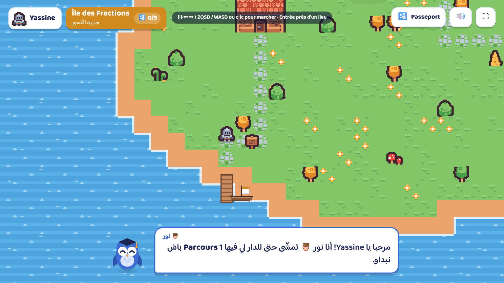
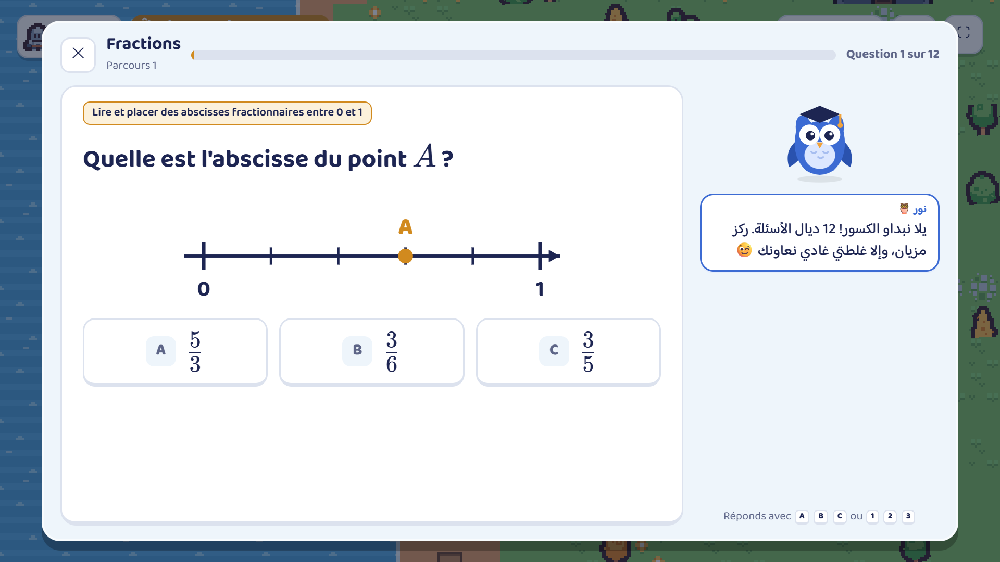
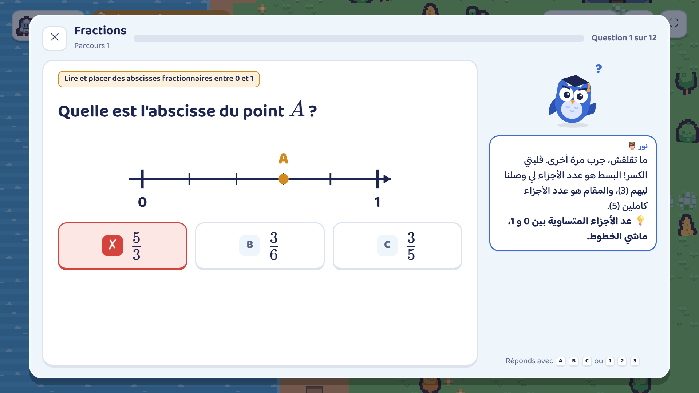

# Math 2AC – jeu d'évaluation en mathématiques

Jeu web pour évaluer la compréhension des élèves de **2ème année collège (Maroc)** en mathématiques.
Il suit le cahier de l'élève : **3 domaines** (Fractions, Nombres positifs et négatifs, Algèbre),
chacun en **3 parcours**, avec des compétences notées 🟢 acquis / 🟡 en cours / 🔴 à revoir et un tampon
**VISA** quand un parcours est validé.



## Le principe

- **Un monde ouvert en 2D** : l'élève choisit un personnage et se déplace sur **3 îles** reliées par un bateau,
  une île par domaine.
- **Chaque parcours est un lieu de l'île.** En s'approchant, **Nour**, un hibou tuteur qui parle en darija,
  propose de commencer, et les questions s'affichent par-dessus le monde.
- **Retour immédiat** : en cas d'erreur, Nour explique l'erreur, donne un indice et laisse un 2e essai.
- **VISA obtenu** : le lieu s'illumine et le chemin vers le parcours suivant s'ouvre.
- Pensé pour la classe : format PC 16:9, lisible au projecteur, fluide sur un PC d'école modeste,
  et fonctionne **sans internet** une fois construit.

| Question | Correction d'une erreur | Passeport de l'élève |
|---|---|---|
|  |  |  |

## Technologies

TypeScript · **Phaser 3** (monde 2D) · **React** (interface) · KaTeX (formules) · Vite.
Les questions sont dans des fichiers JSON (`src/data/`), séparés du code, et vérifiées par `npm run check`.

## Lancer le projet

```bash
npm install
npm run dev
```

## Crédits

Graphismes **CC0** de [Kenney](https://kenney.nl) (Tiny Town, Tiny Dungeon). Détails dans [`CREDITS.md`](CREDITS.md).

## Auteur

Ilyas Benderrou – Master « Ingénierie et data analytique appliquée à l'industrie du gaming », ENS Fès.
